# Widgetkeeper

Extra dashboard widgets for Homey Pro, made to sit naturally next to Homey's own with the same look and feel.

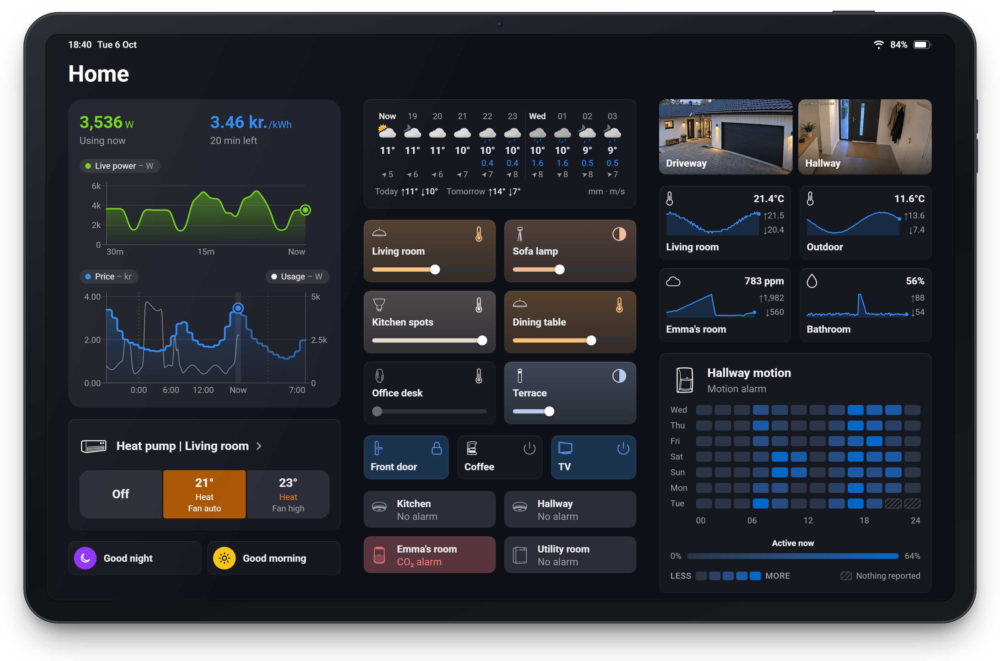

<a href="#electricity-overview"><picture><source media="(prefers-color-scheme: dark)" srcset="docs/previews/electricity-dark.png"></picture></a>
<a href="#electricity-overview"><b>Electricity Overview</b></a> 
Live power use, hourly electricity prices and usage history on one card 

<a href="#thermostat-presets"><picture><source media="(prefers-color-scheme: dark)" srcset="docs/previews/thermostat-dark.png"></picture></a>
<a href="#thermostat-presets"><b>Thermostat Presets</b></a> 
Three one-tap presets for a thermostat, heat pump or air conditioner 

<a href="#device-quick-actions"><picture><source media="(prefers-color-scheme: dark)" srcset="docs/previews/quickactions-dark.png"></picture></a>
<a href="#device-quick-actions"><b>Device Quick Actions</b></a> 
Compact tiles that run a device's quick action with one tap 

<a href="#sensor-alarms"><picture><source media="(prefers-color-scheme: dark)" srcset="docs/previews/sensoralarms-dark.png"></picture></a>
<a href="#sensor-alarms"><b>Sensor Alarms</b></a> 
Tiles that show a sensor's alarm and turn red when one is on 

<a href="#activity-dots"><picture><source media="(prefers-color-scheme: dark)" srcset="docs/previews/sensordots-dark.png">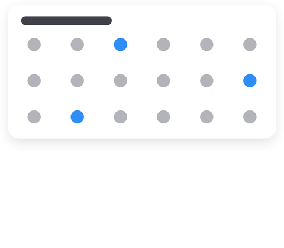</picture></a>
<a href="#activity-dots"><b>Activity Dots</b></a> 
Many motion, contact and vibration sensors at a glance, as dots that change colour when active 

<a href="#room-health"><picture><source media="(prefers-color-scheme: dark)" srcset="docs/previews/roomhealth-dark.png">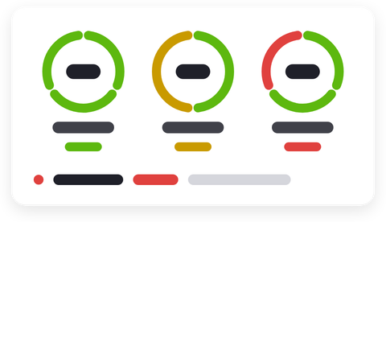</picture></a>
<a href="#room-health"><b>Room Health</b></a> 
Each room's temperature, humidity, CO₂, radon and particles at a glance, as icons or bars that turn yellow to red 

<a href="#value-matrix"><picture><source media="(prefers-color-scheme: dark)" srcset="docs/previews/valuematrix-dark.png">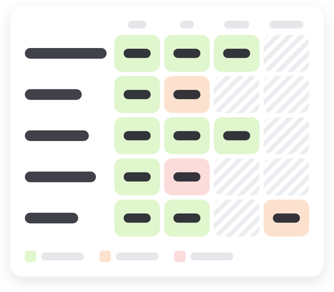</picture></a>
<a href="#value-matrix"><b>Value Matrix</b></a> 
Devices or rooms against the values you choose, in one table: green (OK) inside a value's range, orange (Warning) outside it, red (Alert) far outside 

<a href="#weather-forecast"><picture><source media="(prefers-color-scheme: dark)" srcset="docs/previews/weather-dark.png"></picture></a>
<a href="#weather-forecast"><b>Weather Forecast</b></a> 
The next 36 hours, hour by hour, from MET Norway (yr.no) 

<a href="#insights-heatmap"><picture><source media="(prefers-color-scheme: dark)" srcset="docs/previews/heatmap-dark.png">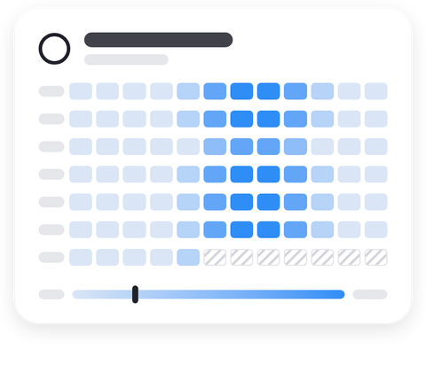</picture></a>
<a href="#insights-heatmap"><b>Insights Heatmap</b></a> 
A week of one value (light, temperature, motion …) as a grid of weekdays and hours 

<a href="#cameras"><picture><source media="(prefers-color-scheme: dark)" srcset="docs/previews/cameras-dark.png"></picture></a>
<a href="#cameras"><b>Cameras</b></a> 
Two to six cameras in one grid of snapshots; tap one to watch it live 

<a href="#device-values"><picture><source media="(prefers-color-scheme: dark)" srcset="docs/previews/values-dark.png">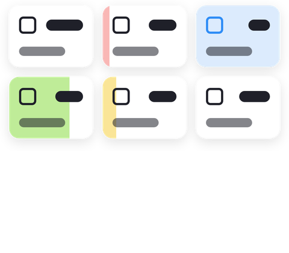</picture></a>
<a href="#device-values"><b>Device Values</b></a> 
Compact tiles that each show one value, such as a temperature, power or on/off 

<a href="#light-controls"><picture><source media="(prefers-color-scheme: dark)" srcset="docs/previews/lights-dark.png"></picture></a>
<a href="#light-controls"><b>Light Controls</b></a> 
Compact light tiles with brightness, colour and colour temperature: six lights in the space of three 

<a href="#sparklines"><picture><source media="(prefers-color-scheme: dark)" srcset="docs/previews/sparklines-dark.png"></picture></a>
<a href="#sparklines"><b>Sparklines</b></a> 
Tiles with a small chart of a value over the last hour, day or week, with its lowest and highest 

<a href="#charts"><picture><source media="(prefers-color-scheme: dark)" srcset="docs/previews/charts-dark.png">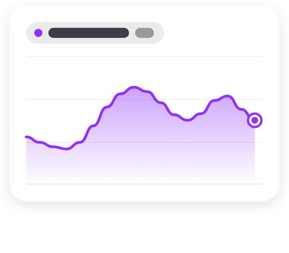</picture></a>
<a href="#charts"><b>Charts</b></a> 
One or two charts of any value over the last hour, day or week, drawn like Electricity Overview's 

<a href="#variables"><picture><source media="(prefers-color-scheme: dark)" srcset="docs/previews/variables-dark.png"></picture></a>
<a href="#variables"><b>Variables</b></a> 
Compact rows to switch variables on and off or change a number or text, with the full name 

<a href="#variable-presets"><picture><source media="(prefers-color-scheme: dark)" srcset="docs/previews/varpresets-dark.png"></picture></a>
<a href="#variable-presets"><b>Variable Presets</b></a> 
Two to four one-tap buttons that set a variable to the values you pick, like Thermostat Presets 

<a href="#flow-buttons"><picture><source media="(prefers-color-scheme: dark)" srcset="docs/previews/flows-dark.png"></picture></a>
<a href="#flow-buttons"><b>Flow Buttons</b></a> 
Start flows with one tap: a round button in the colour and icon you pick, with the flow's name 

<a href="#energy-price-strip"><picture><source media="(prefers-color-scheme: dark)" srcset="docs/previews/price-dark.png">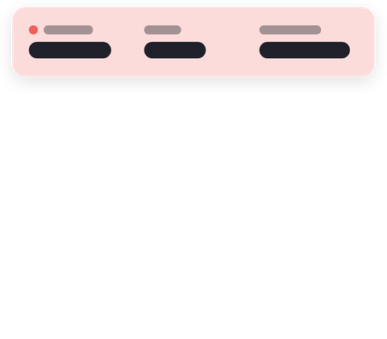</picture></a>
<a href="#energy-price-strip"><b>Energy Price Strip</b></a> 
The electricity price now and the coming hours as small bars, green, yellow or red 

<a href="#timers"><picture><source media="(prefers-color-scheme: dark)" srcset="docs/previews/timers-dark.png"></picture></a>
<a href="#timers"><b>Timers</b></a> 
Kitchen timers from one-tap presets, with a Flow card when one runs out 

<a href="#locks-and-doors"><picture><source media="(prefers-color-scheme: dark)" srcset="docs/previews/locks-dark.png">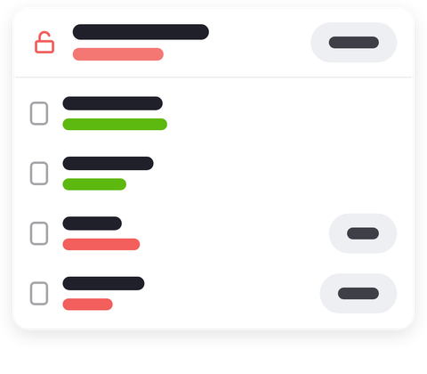</picture></a>
<a href="#locks-and-doors"><b>Locks and Doors</b></a> 
One line that says whether every lock and door is locked and closed 

<a href="#curtains"><picture><source media="(prefers-color-scheme: dark)" srcset="docs/previews/curtains-dark.png"></picture></a>
<a href="#curtains"><b>Curtains</b></a> 
Curtains and blinds that open or close with one tap, with a slider for anything in between 

<a href="#media"><picture><source media="(prefers-color-scheme: dark)" srcset="docs/previews/media-dark.png"></picture></a>
<a href="#media"><b>Media</b></a> 
A speaker with its album art, mute, a volume that never overshoots and buttons for its sources 

<a href="#smart-stack"><picture><source media="(prefers-color-scheme: dark)" srcset="docs/previews/stack-dark.png"></picture></a>
<a href="#smart-stack"><b>Smart Stack</b></a> 
Several widgets in one spot, one at a time, with the one that matters brought forward 

<a href="#clock"><picture><source media="(prefers-color-scheme: dark)" srcset="docs/previews/clock-dark.png">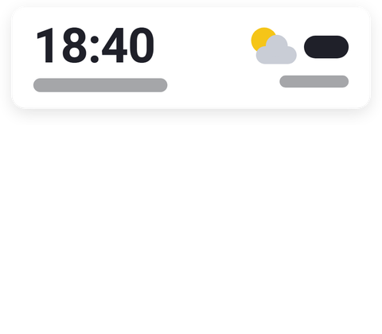</picture></a>
<a href="#clock"><b>Clock</b></a> 
The time and the date, with the weather now and today's high and low 

<a href="#notes"><picture><source media="(prefers-color-scheme: dark)" srcset="docs/previews/textline-dark.png">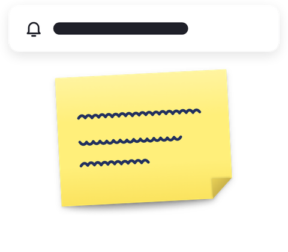</picture></a>
<a href="#notes"><b>Notes</b></a> 
A note on a tile or a handwritten Post-it, typed in or written by your Flows 

<a href="#days-since"><picture><source media="(prefers-color-scheme: dark)" srcset="docs/previews/dayssince-dark.png">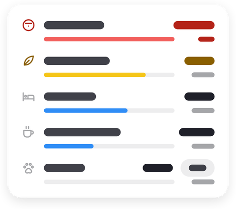</picture></a>
<a href="#days-since"><b>Days Since</b></a> 
How long since the plants were watered or the filter changed, amber and then red when it's due; tap to reset 

<a href="#spacer"><picture><source media="(prefers-color-scheme: dark)" srcset="docs/previews/spacer-dark.png"></picture></a>
<a href="#spacer"><b>Spacer</b></a> 
Empty space of the height you set, to line up widgets across columns 

## Electricity Overview
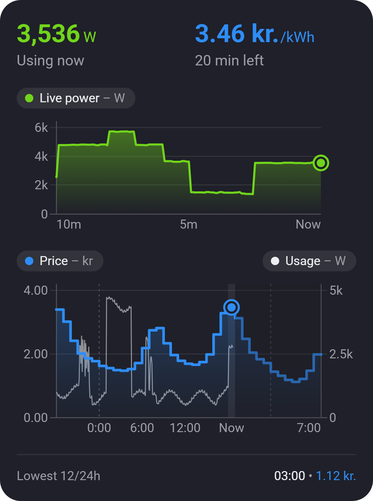

Live power use, the hourly price from yesterday to 12 hours ahead (with your tariffs and taxes from Homey Energy), the last 24 hours of usage and the cheapest hour ahead. Tap a chart to see its values. Works with a fixed price too, and shows solar export below zero.

**Settings:** power meter, live time span, prices, tariffs and taxes, usage history, smooth lines, lowest price in 12 h / 24 h, compact layout, [colour style](#colour-style).

## Thermostat Presets
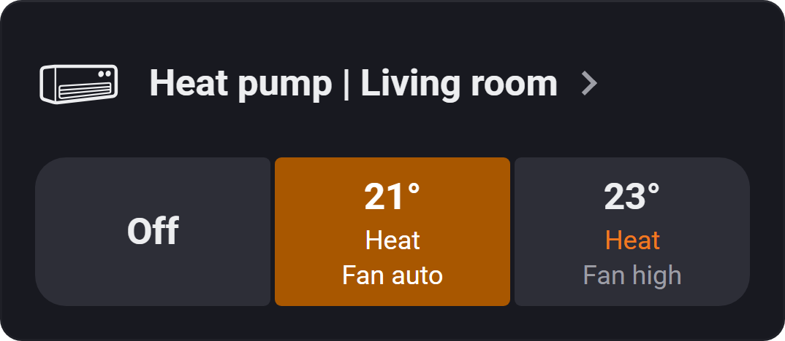

Three one-tap presets for a thermostat, heat pump or air conditioner, such as *Off*, *Heat 21°* and *Heat 24° · Fan level 5*. The matching preset lights up.

**Settings:** the device, compact layout, [colour style](#colour-style), and per button: power, mode, temperature and one extra option such as the fan speed.

## Device Quick Actions
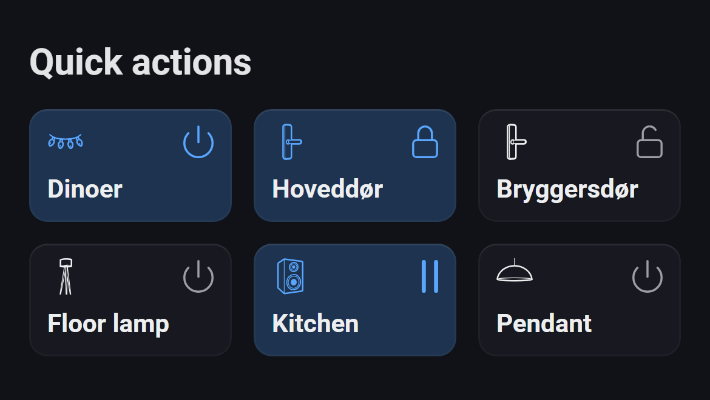

Half-height tiles that run a device's quick action with one tap (on/off, lock, play/pause, a button), highlighted while it's on.

**Settings:** devices, active style, colour, [colour style](#colour-style), [rename tiles](#tile-names).

## Sensor Alarms
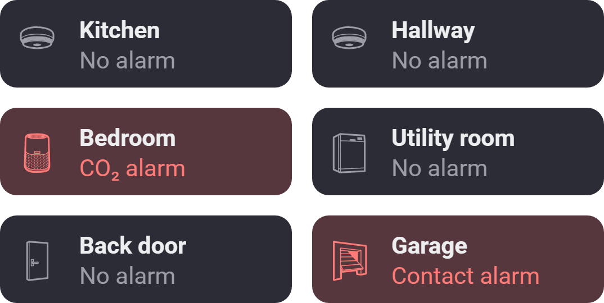

Tiles that show *No alarm*, the alarm that's on or how many, and turn red while one is. Every alarm counts, including apps' own such as radon. Tap a tile for all of its alarms.

**Settings:** sensors, count motion and contact, [colour style](#colour-style), [rename tiles](#tile-names).

## Activity Dots
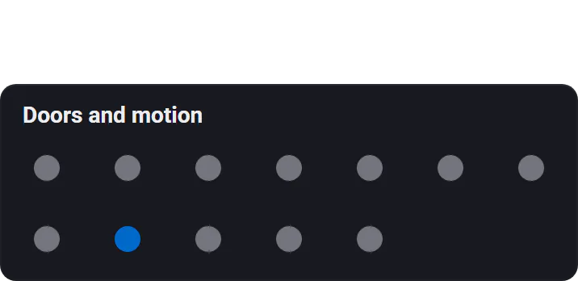

Motion, contact, vibration and camera sensors as a grid of dots that light up while active. Tap a dot for its name and since when, such as *Garage · Open since 18:17*.

**Settings:** sensors, title, idle and active colours, [colour style](#colour-style).

## Room Health
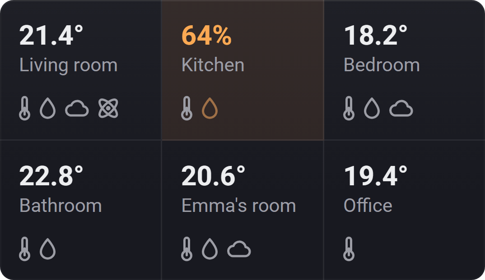

The indoor climate of the whole house on one card. Pick the sensors, and they're grouped by their Homey room: each room shows its worst value large (else the temperature), its name, and a mark for every value it has: an icon, or a bar with the *Bars* layout. The marks line up from room to room in a fixed order (temperature, humidity, CO₂, radon, PM2.5, PM10, VOC). A value that's comfortable is grey, or green with *Green when fine*; outside its range it turns yellow, then red the further it is outside, and so does the large value. Tap a room to step through its other readings.

| Value | Comfortable by default | Red at |
|---|---|---|
| Temperature | 18–24 °C (18 °C is WHO's minimum) | 3 °C outside |
| Humidity | 30–60 % | 10 points outside |
| CO₂ | up to 1000 ppm | 1.5 × the limit |
| Radon | up to 100 Bq/m³ (WHO's reference level) | 1.5 × |
| PM2.5 | up to 15 μg/m³ (WHO's 24-hour guideline) | 1.5 × |
| PM10 | up to 45 μg/m³ (WHO's 24-hour guideline) | 1.5 × |
| VOC | up to 1000 ppb | 1.5 × |

A room shows whatever its sensors measure; a room with only a thermometer is judged on temperature. A heat pump's room temperature counts, its outdoor and water temperatures don't. Left out on purpose: carbon monoxide (a safety alarm: use [Sensor Alarms](#sensor-alarms)), air quality indexes and VOC in μg/m³ or as an index (their scales differ between devices), and PM1 (no guideline).

**Settings:** sensors, [rename tiles](#tile-names), [colour style](#colour-style), icons or bars, green when fine, the comfortable range of each value (one range for every room).

## Value Matrix
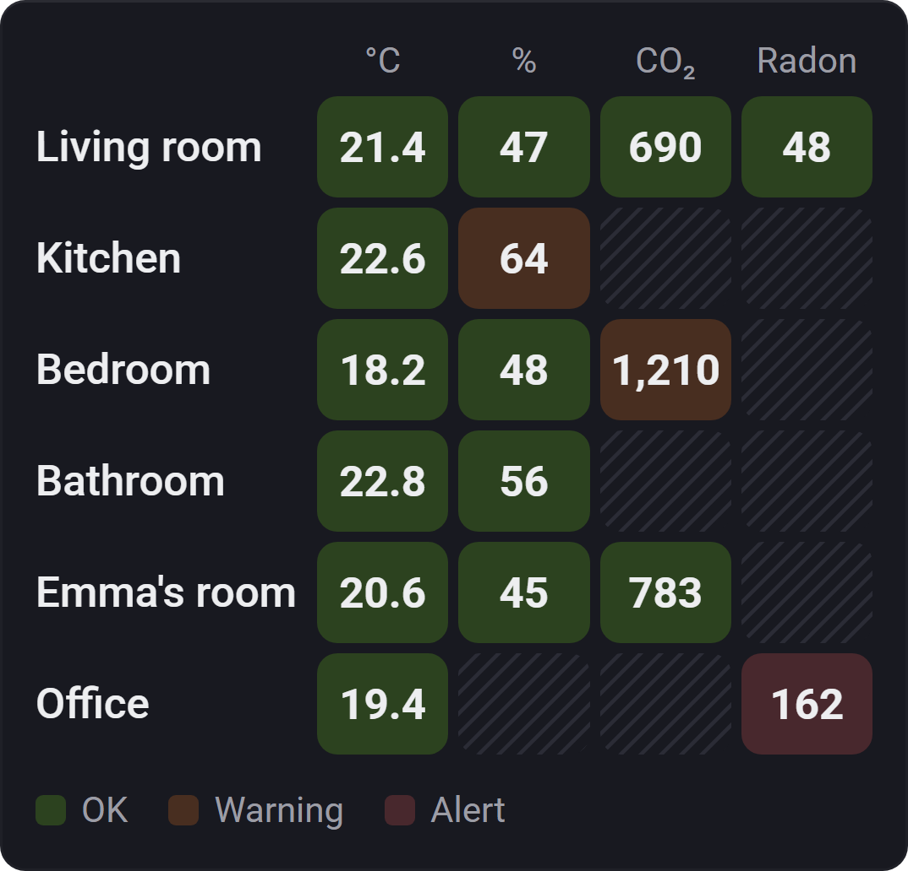

Any devices against any values, in one table. Pick the devices, then up to six values for the columns (temperature, humidity, CO₂, power, battery: any number a device has). The rows are the devices' Homey rooms, each value the average of the room's devices, or the devices themselves with *Rows: Devices*. A cell is green (OK) inside the column's range, orange (Warning) outside it, and red (Alert) once it's past by half the range (for a limit on one side, half the limit: 1.5 × a highest value). A device or room without that value gets a striped cell. A legend of the three colours is under the table.

Each column has an OK range, typed like `18–24`, `<1000` or `>10` in the value's unit. Left empty, temperature (°C), humidity, CO₂, radon (Bq/m³), PM2.5, PM10 and VOC (ppb) get [Room Health's](#room-health) usual ranges, and other values none (no colour). Type `–` for no range at all. The header is the unit (°C, %) or a short name, unless you type your own.

**Settings:** devices, [rename tiles](#tile-names), [colour style](#colour-style), rooms or devices as rows, show legend, and per column the value, its OK range and its header.

## Weather Forecast
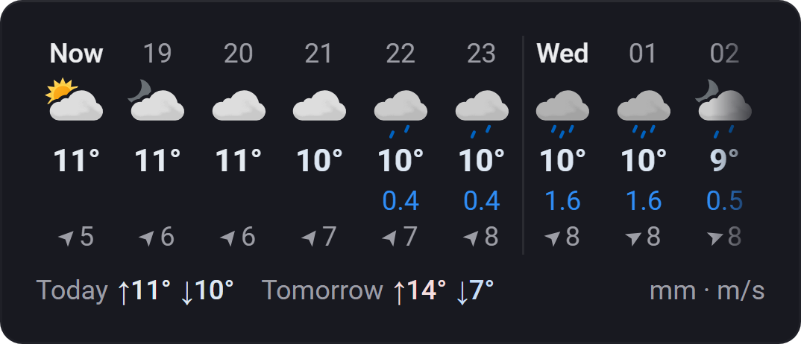

The next 36 hours from [MET Norway](https://www.met.no/en) ([yr.no](https://www.yr.no)), hour by hour, with today's and tomorrow's high and low. Swipe sideways to see further ahead.

**Settings:** compact or detailed, one or two rows, 1–3 hours per column, colour style: Standard, Warm and cold (coloured temperatures) or [Vivid](#colour-style) (the card on a gradient for the current weather).

Weather data from MET Norway, licensed under [CC BY 4.0](https://creativecommons.org/licenses/by/4.0/). Icons: [Yr's weather symbols](https://github.com/metno/weathericons) (MIT).

## Insights Heatmap
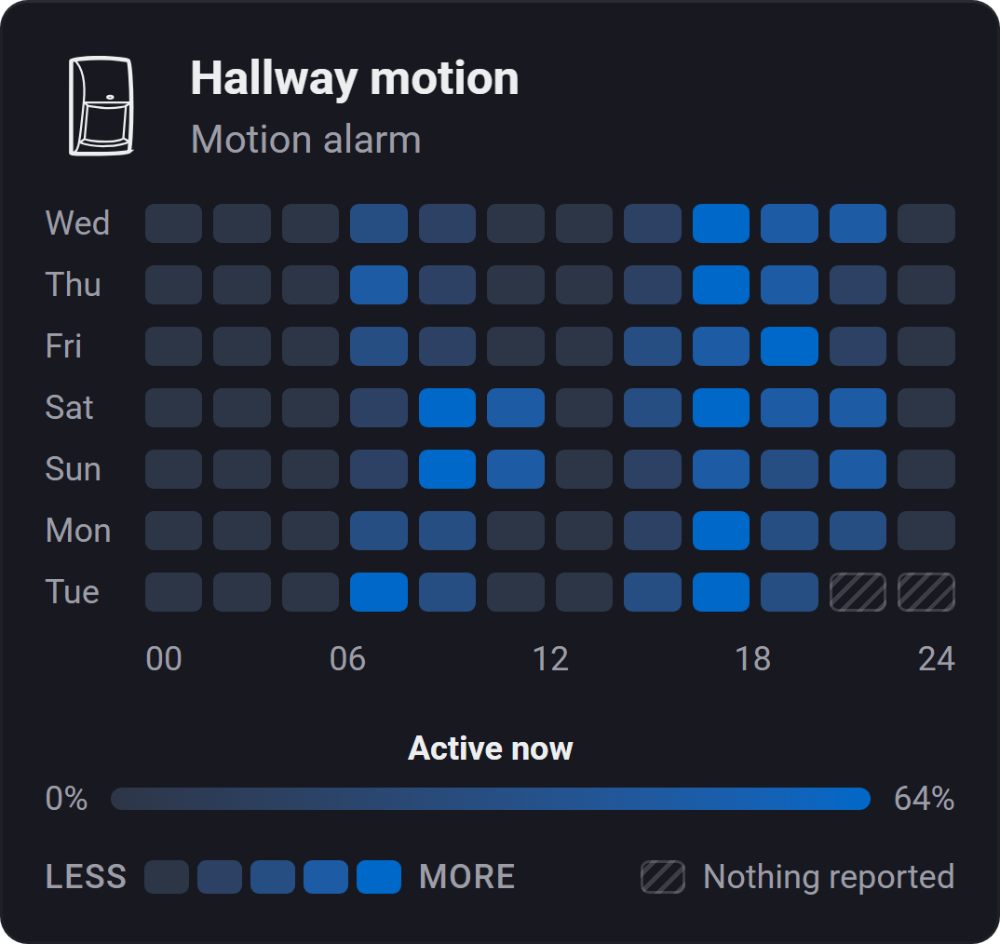

A week of one Insights value as a grid of days and hours: numbers such as light or temperature, or how much of each hour a sensor was on.

**Settings:** device and value, this week or the last 3–14 days, hours per column, colour, [colour style](#colour-style), scale, legend.

## Cameras

Your cameras as a grid of snapshots that refresh every few seconds (cameras with only a video stream show a still from it). Tap one to watch it live.

**Settings:** cameras, layout (the large camera at the top or the bottom, or one per row), refresh interval, how long live view stays on (30 seconds to 5 minutes, or until you tap it again), [rename tiles](#tile-names).

## Device Values

Half-height tiles that each show one live device value, and if you like a second value of the same device small beside the name, such as a room's humidity next to its temperature. Percentages can fill their tile by level, and the Flow card **Set the tile colour of … to …** colours a tile, such as a fridge going red when it's too warm.

**Settings:** up to six values, each with an optional second value, 3 or 2 per row, compact or pill tiles (pill tiles look like Sensor Alarms'), [colour style](#colour-style) (Vivid fills percentage fills and the colours a Flow sets), percentage fill and its limits, [rename tiles](#tile-names).

## Light Controls
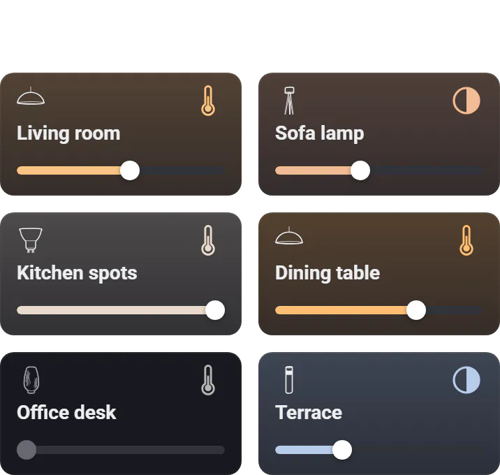

Six lights in the space of three of Homey's light cards. Tap a tile to switch it, drag or tap the bar to dim, and tap the colour button for colours and whites. Lights in a room can share one tile. The Room's Moods palette puts the room's Homey Moods on the colour button instead of the colours and whites; starting one needs an [API key](#api-key) with **Set Moods**.

**Settings:** lights, group by room, what the bar's far left does, colour palette, [colour style](#colour-style), [rename tiles](#tile-names).

## Sparklines

Device Values' tiles with a small live chart of each value and its highest and lowest.

**Settings:** up to six values, time span (1 hour to 7 days), 2 or 1 per row, [colour style](#colour-style), [rename tiles](#tile-names).

## Charts
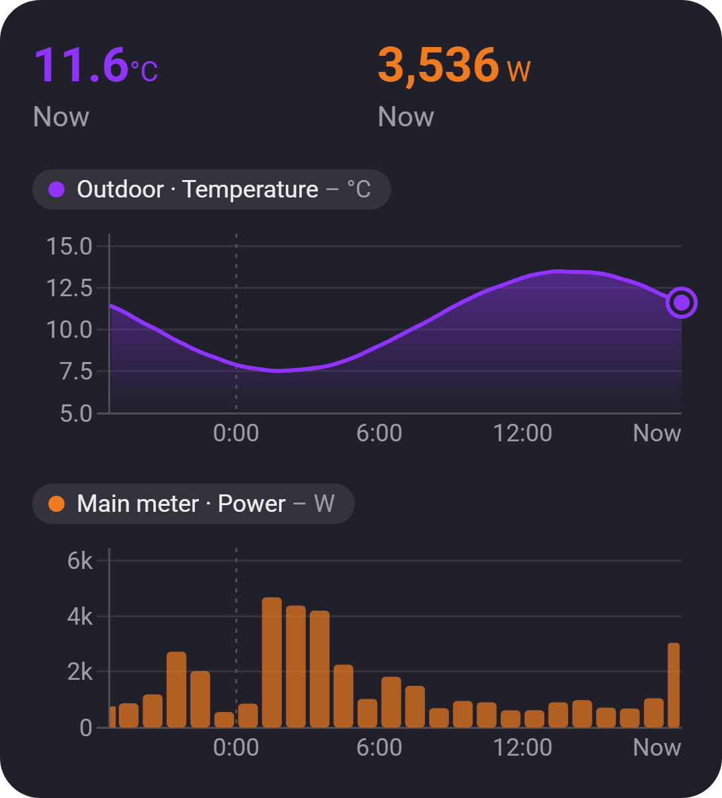

One chart, two stacked, or two values on one chart (each with its own scale), of any value that Homey logs in Insights, drawn like Electricity Overview's charts. The value now sits at the top in the chart's colour. Tap a chart to see the value at that moment.

**Settings:** one chart, two stacked or two on one chart; for each, the value, the time span (1 hour to 7 days), line with area, line or bars, the colour, a scale that fits the values or starts at zero, below zero in yellow, a smooth line and a title. The values at the top can be turned off. [Colour style](#colour-style).

## Variables
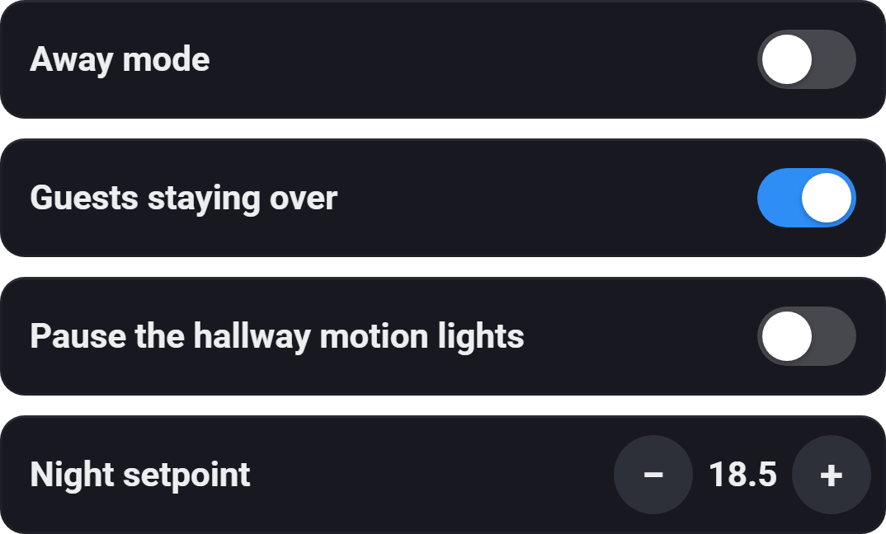

Logic variables as compact rows with their full name: a switch for yes/no, − and + for a number, and the text for a string. Tap a number or text to type a value. Needs an [API key](#api-key) with **Variables** to change them. Read only shows the values without anything to tap (a dot and Yes/No for yes/no), and needs no key.

**Settings:** up to ten variables, 1 or 2 columns, colour, [colour style](#colour-style), read only, the − and + step, the lowest and highest number, [rename tiles](#tile-names).

## Variable Presets
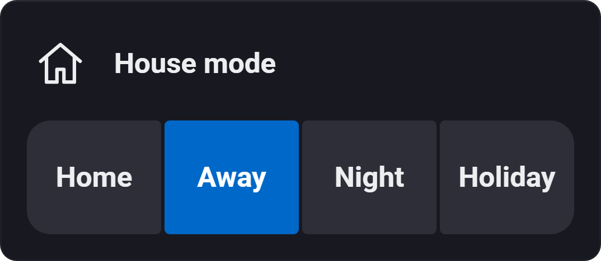

One Logic variable with two to four buttons, each setting it to a value you pick, such as *Home*, *Away* and *Night* for a house mode, or two setpoints. It looks like Thermostat Presets: the button whose value the variable has lights up in your colour, and when none does, the name says what it is now. A yes/no variable without buttons set gets Yes and No. Needs an [API key](#api-key) with **Variables** to change the variable.

**Settings:** the variable, a title instead of its name, an icon, compact layout, the button colour, [colour style](#colour-style), and per button: the value (Yes or No, a number or a text, as the variable is; pick the variable first) and a label.

## Flow Buttons
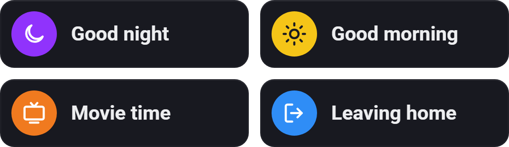

Flows and Advanced Flows as rows with a round button in your colour and icon. Tap a row to start the flow. Needs an [API key](#api-key) with **Start Flows**. The Flow card **Set the button colour of … to …** colours the buttons that start a flow, such as green while an e-bike charges; **Default** gives them their own colour again.

**Settings:** up to eight flows, each with a colour, an icon and an optional name; 1 or 2 columns; [colour style](#colour-style).

## Energy Price Strip

The electricity price now, and the coming 12, 24 or 36 hours as small bars in one tile: green, yellow or red by each hour's level in its day, with a dot over the cheapest. Uses the Electricity Overview's prices and needs no meter.

**Settings:** hours ahead, colour by level, [colour style](#colour-style), tariffs and taxes.

## Timers
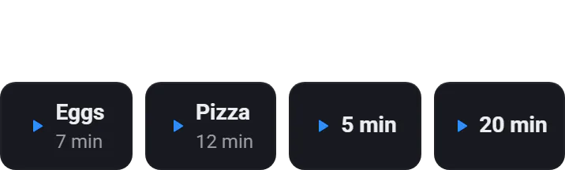

Up to four preset buttons, such as *Eggs · 7 min*. A started timer takes their place: tap to pause, **+1** for a minute more, **✕** to cancel. It beeps and turns red when done. The timer runs on Homey, so every screen sees it and the Flow card **A timer finished** fires with no dashboard open.

**Settings:** colour, [colour style](#colour-style), four presets with minutes and an optional name, sound.

## Locks and Doors
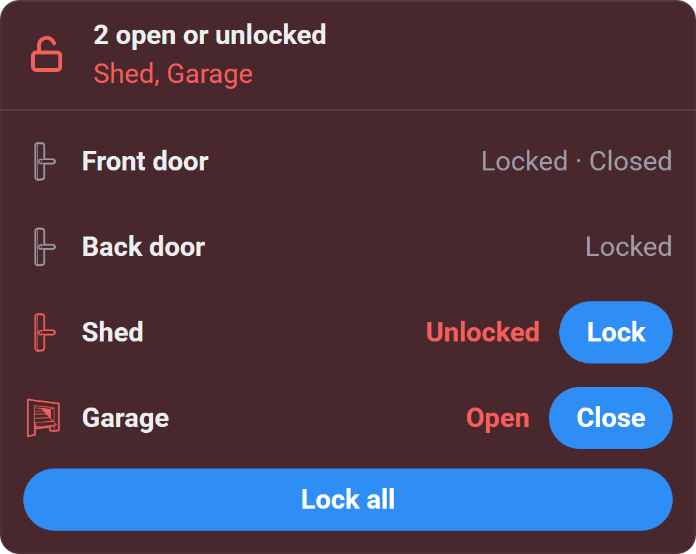

Locks, doors, windows and garage doors in one line: *All locked and closed*, or what isn't, on a red tile. Tap it for the list, with **Lock** and **Close** buttons. A lock that can pull the latch can get an **Open** button too: pick the capability that does it (such as *open_lock* or *open*), and tap it twice to open the door.

**Settings:** devices, one line or the full list, allow unlocking, the open door button, [colour style](#colour-style), [rename tiles](#tile-names).

## Curtains
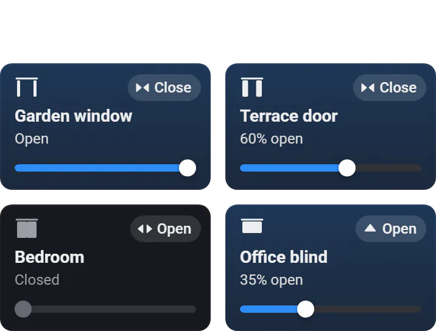

Curtains and blinds as tiles: tap to open or close (the corner label says which), or use the slider for anything between. A tap while it moves sends it back.

**Settings:** devices, what a tap does halfway, inverted position (leave it off when the device's own invert setting already flips it), how close to the end counts as open or closed, state line, group by room, colour, [colour style](#colour-style), [rename tiles](#tile-names).

## Media
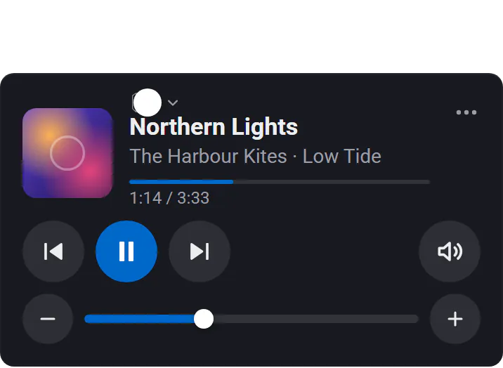

One speaker as a card: album art, the track, play controls, mute, and a volume that moves on every tap but never overshoots or passes your maximum. Shows TV and line-in instead of old album art. Tap the name to switch speaker. Up to four buttons behind ⋯ run the speaker's own actions (such as *Set source to TV*), its app's (such as Sonos (LocalAPI)'s *Scan the music library*) or flows; they need an [API key](#api-key), with **Flows** for the actions and **Start Flows** for flows. A large layout puts the album art across the whole widget, with bigger text and buttons below it.

**Settings:** layout (compact or large), colour, [colour style](#colour-style), speaker, speaker switching, volume as a bar or buttons, volume step and maximum, progress, shuffle and repeat, four buttons with an icon and a name.

## Smart Stack
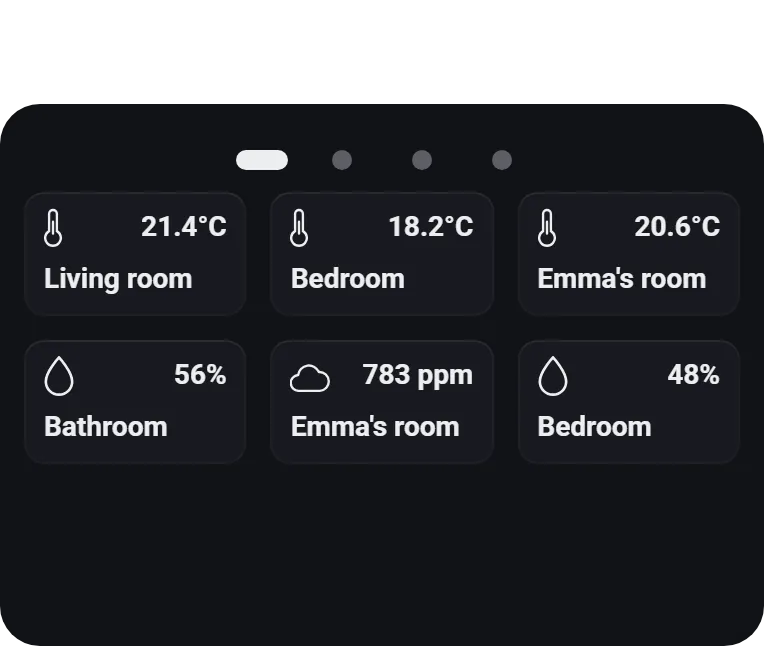

Widgetkeeper widgets from another dashboard, one at a time in the space of one. It turns every 30 seconds, and swipes or the dots move it by hand. Smart rotate brings a widget forward while something happens on it: music plays, a timer runs, a camera sees someone, a door is open. A Flow card can bring one forward too. Needs an [API key](#api-key) with the **Homey** permission to read the dashboard.

**Settings:** dashboard, interval, smart rotate, pause after a swipe, dots.

## Clock
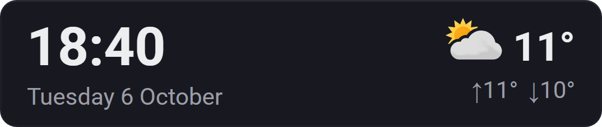

The time and the date in one tile, with the weather now and today's high and low from [MET Norway](https://www.met.no/en), the Weather Forecast's data. The time follows your phone or tablet (24 or 12 hours), the date Homey's language.

**Settings:** show the weather.

## Notes
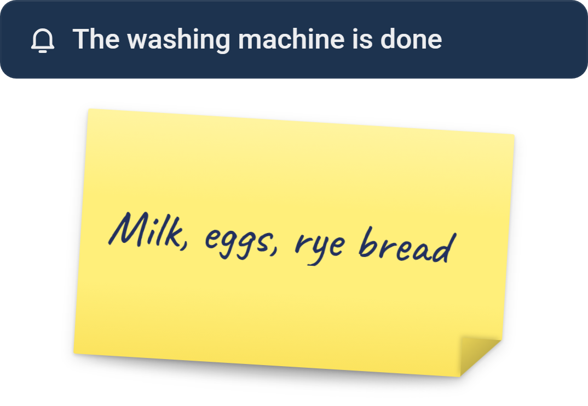

A short message on the dashboard, as a tile with one line of text or as a Post-it note stuck on it, tilted, with a folded corner and written in handwriting. Type the message in the widget's settings, or let a Flow write it: *Write [text] on the note [name]*, optionally in a colour (red for *Dryer done*), and *Clear the note [name]*. Every Notes widget with that name shows it, on every screen, at once. It can show a Logic text variable instead. On the tile, long text is cut off or scrolls; the Post-it wraps it to three lines.

**Settings:** style (tile or Post-it), text from (the message typed in the settings, a Flow card or a text variable), message, note name, variable, alignment, text size, long text, icon, colour, [colour style](#colour-style).

## Days Since
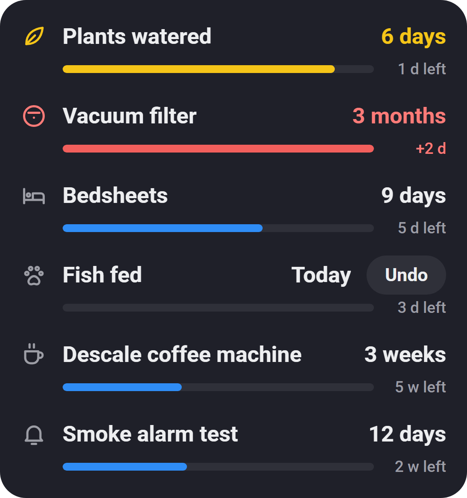

Counters for the things you do every so often: plants watered *6 days* ago, the vacuum filter changed *3 months* ago, the sheets *2 weeks*. They're a list on one card: each counter's bar fills up towards the day it's due, with the time left under it. A counter turns amber, then red, the number of days you set after it was last done, and then says how long it's overdue (*+2 d*). Tap a row when you've done it: it starts again from *Today*, with **Undo** for a few seconds. The counters are kept on Homey by name, so every widget (and every screen) with the same counter shows the same one.

Flow cards: *Reset [counter]* (when the robot vacuum is done, for instance), *Set [counter] to [days] days ago* (for something done before you added the widget), the trigger *[counter] became overdue* (when it turns red, even with no dashboard open) and the condition *[counter] is overdue*; the last two also take *Any counter*.

**Settings:** days only or days, weeks and months; [colour style](#colour-style); up to eight counters, each with a name, an icon and the days until amber and red.

## Spacer
An empty widget of the height you set, in pixels, to line up widgets of different heights at the top or bottom across a dashboard's columns. It's transparent in light and dark mode, and Homey keeps its usual gap above and below it.

**Settings:** height.

## Web dashboards
Your Widgetkeeper widgets in any browser on your home network: a wall tablet, an old iPad, a computer or a TV. Turn them on under **Apps → Widgetkeeper → Configure**, open the address shown there (`http://<your Homey's address>/app/com.thomassidor.widgetkeeper/settings/dashboard.html`), paste a Homey API key ([which permissions](#web-dashboards-key)) (and, if you set one there, the web dashboards password), and build the dashboards on the page itself: columns of widgets, each with the same settings as on a Homey dashboard, in light, dark or automatic. They're the same widgets with the same live updates, and the dashboards are kept on your Homey, so every browser shows them. Widgets from your other apps can go on them too ([key](#web-dashboards-key)). Home network only for now.

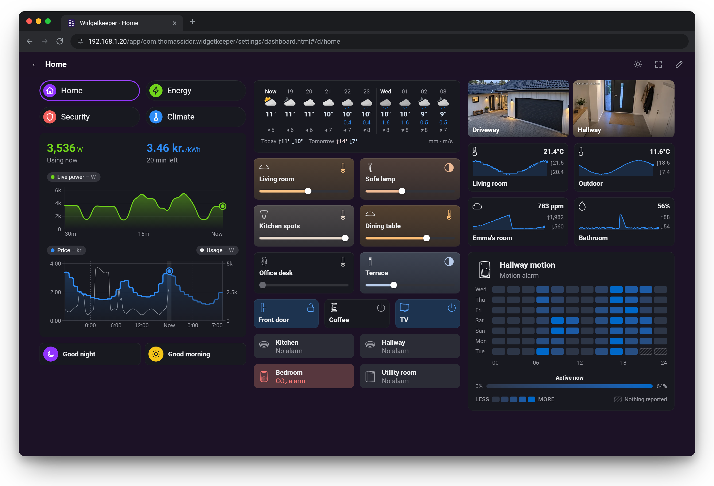

**Your dashboards:** the front page, with every dashboard and the widgets you can add.
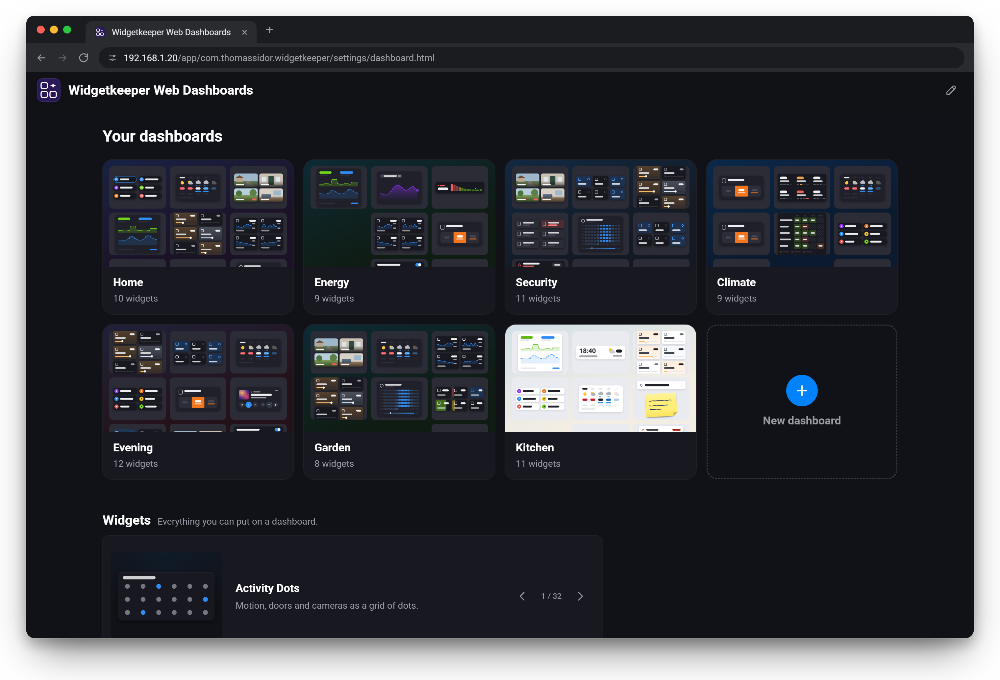

**Editing:** move widgets by dragging or with the arrows, change their settings, add and remove them.
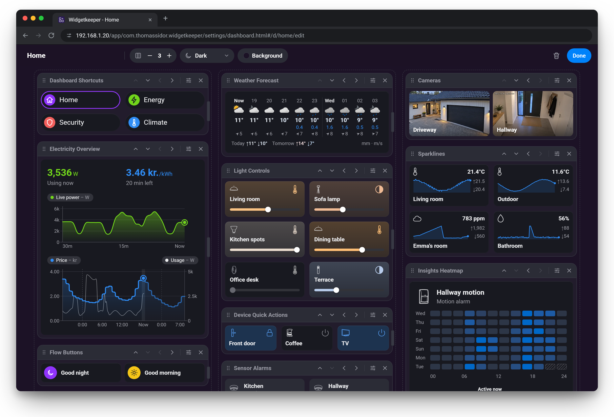

<picture><source media="(prefers-color-scheme: dark)" srcset="docs/previews/shortcuts-dark.png">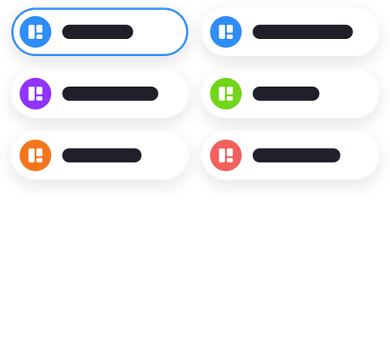</picture>
<b>Dashboard Shortcuts</b> (web dashboards only): your other web dashboards as buttons, each with a round icon in the colour and icon you pick; a tap opens that dashboard. The one you're on is ringed, so the same widget can go on every dashboard as a menu. Give the buttons their own names with <a href="#tile-names">Rename tiles</a>. 

**Settings:** up to eight dashboards, each with a colour and an icon; 1 or 2 columns; [colour style](#colour-style); [rename tiles](#tile-names).

## Dashboard examples
**Home**

**Energy**
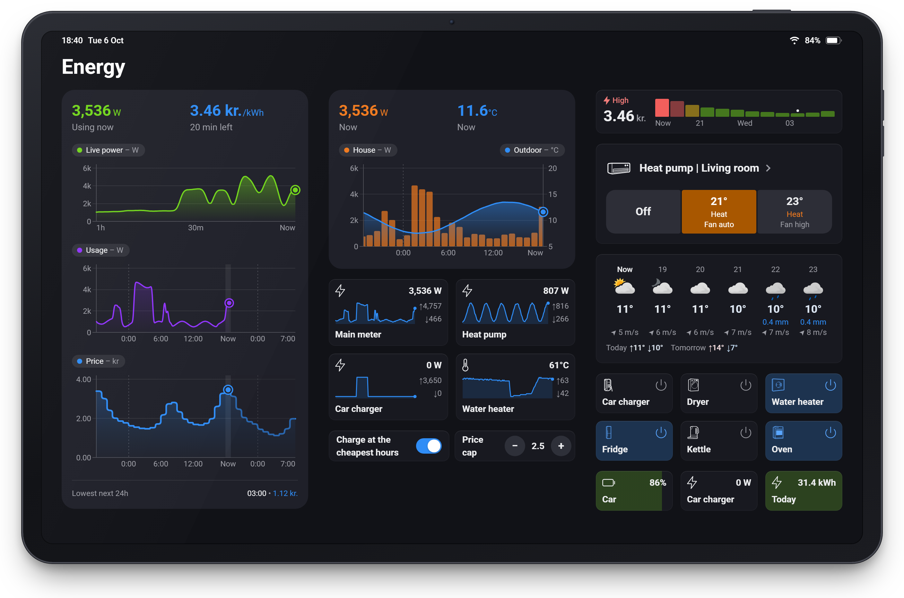

**Security**
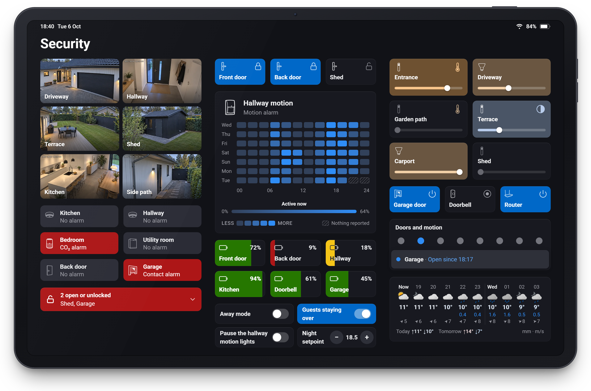

**Climate**
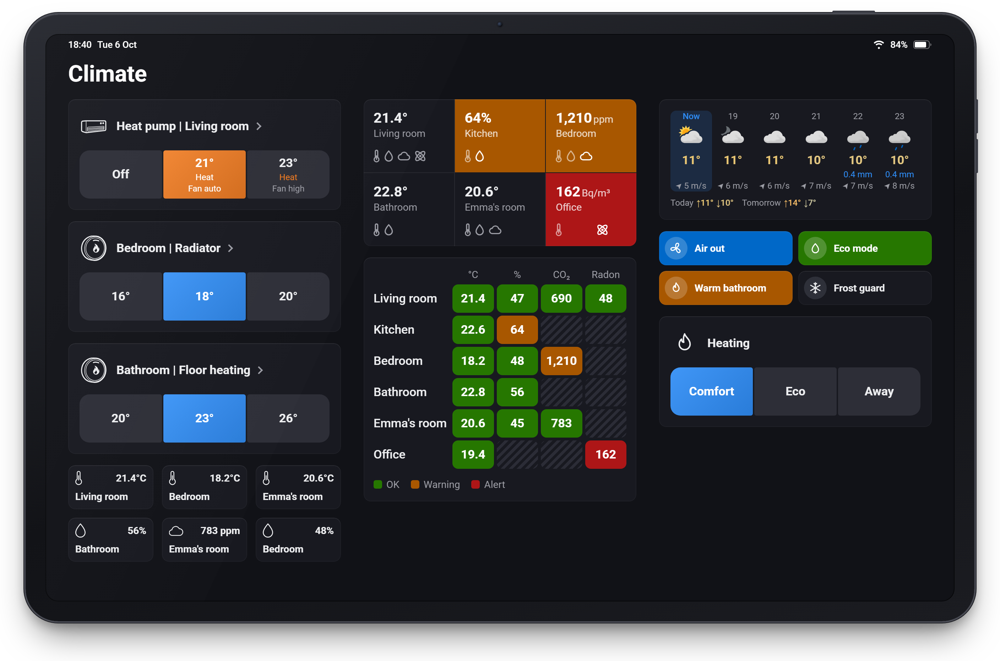

**Evening**
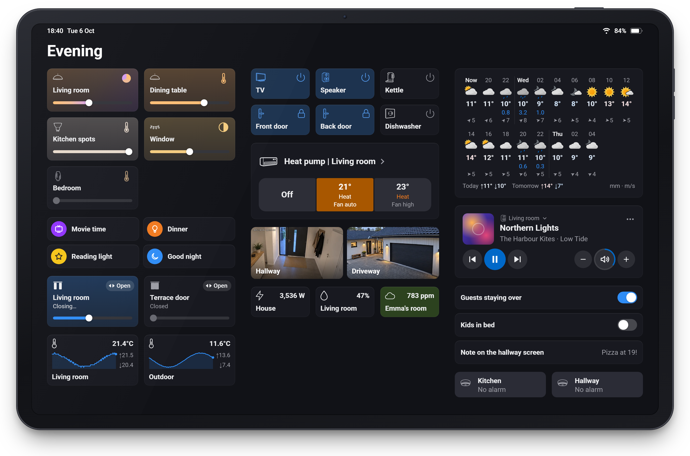

**Garden**

**Kitchen**

## Colour style
Every widget with a coloured state has a **Colour style** setting: *Muted* is the calmer look, *Vivid* the stronger one.

- Where a colour is mixed softly into a tile (a Quick Actions tile that's on, a Sensor Alarms alarm, a Flow Buttons row, a coloured note, Curtains, Timers, Variables, Value Matrix's cells …), Vivid fills the tile with Homey's darker shade of the colour, with white text (dark on yellow). Lights take a darker shade of their own colour, and the charts get a stronger area under their lines.
- Where the colour is already a small solid part (the lit button of Thermostat and Variable Presets, Insights Heatmap's cells, Media's play button and what's on, Activity Dots' dots), Muted uses Homey's darker shade and Vivid the full, bright colour.
- Days Since shows the level only on its bars by default, and Vivid puts an overdue row on a solid block. Room Health's icons and bars are toned down by default and in full colour in Vivid. Weather Forecast has *Vivid* among its colour styles: the whole card on a gradient for the current weather.

Where a widget lets you pick a colour (Flow Buttons, Device Values' Flow colours, Notes, Charts, Insights Heatmap, Activity Dots, Variable Presets, and now Device Quick Actions, Variables, Curtains, Media and Timers), the colour you pick follows the setting.

## Tile names

Give any tile a name of your own, such as *Sofa corner* for a room's lights grouped by room, instead of the device's or room's name. Light Controls, Curtains, Device Quick Actions, Sensor Alarms, Room Health, Value Matrix, Device Values, Sparklines, Locks and Doors, Cameras, Variables and (on web dashboards) Dashboard Shortcuts can do this.

1. Edit the dashboard, edit the widget, turn on **Rename tiles** (the first setting) and save the widget.
2. Leave the dashboard's edit mode. Each tile now shows a text field: type its name, or leave it empty to keep the device's (or room's) own name.
3. Edit the widget again and turn **Rename tiles** off.

The names belong to that widget: they stay with the right tiles when you rename or reorder devices, every screen showing the dashboard gets them, and a Smart Stack showing the widget does too. Sensor Alarms, Device Values and Variables used to name their tiles in the widget settings. Those settings are gone, so type the names on the tiles again (Variables' names were carried over on web dashboards and Smart Stacks).

## API key
Homey doesn't let apps change variables, start flows, read dashboards or start Moods on their own. For those, create a key in the Homey web app under **Settings → API Keys**, tick the permissions below for the widgets you use, and paste it under **Apps → Widgetkeeper → Configure**. The key stays on your Homey, and that page says what it may do once it's saved.

| What | Permission to tick | Scope |
|---|---|---|
| Variables and Variable Presets: changing a value | **Variables** (View Variables isn't enough) | `homey.logic` |
| Flow Buttons | **Start Flows** | `homey.flow.start` |
| Media's buttons: a flow | **Start Flows** | `homey.flow.start` |
| Media's buttons: the speaker's own actions, such as *Set source to TV*, and its app's | **Flows** (Start Flows isn't enough) | `homey.flow` |
| Light Controls' Room's Moods: starting a Mood | **Set Moods** | `homey.mood.set` |
| Smart Stack: reading the dashboard | **Homey**: the API Keys page has no permission for dashboards alone, so it takes the top one, which allows everything | `homey` |

Ticking a group's first box (**Flows**, **Moods**, **Homey**) includes the boxes under it. Everything else needs no key: the widgets read devices, Insights, variables, flows and Moods with Widgetkeeper's own permissions, and Variables' Read only shows values without one. The scopes are the ones Homey's Web API asks for (`updateVariable`, `triggerFlow`/`triggerAdvancedFlow`, `runFlowCardAction`, `setMood`, `getDashboards`); the API Keys page shows each one beside its box.

### Web dashboards' key
Each browser connects with a key of its own, which stays in that browser:

- The page itself only talks to Widgetkeeper: its own API and its live updates. A key with the **Homey** permission works; whether a narrower key does hasn't been tried yet, as Homey doesn't document which permission an app's own API takes.
- A widget that changes something also needs that permission in the browser's key, as in the table above, even though the change is made with the key in the app's settings. So a browser whose key may not start flows can't start them through the app's key either.
- The Smart Stack on a web dashboard reads its dashboard with the app's key, so the browser's key needs **Homey** too.
- Other apps' widgets (*Add widget* → **Other apps**) need **Homey** in the browser's key: Homey only lists them, and answers their settings' searches, with that. They run in a sandbox, so their code can't read the page or the key stored in the browser. A widget that doesn't work there can be trusted in its settings (*Trust this widget*); it then runs as on a Homey dashboard and could read the key.

## Languages
English, Dutch, German, French, Italian, Swedish, Norwegian, Spanish, Danish, Russian, Polish, Korean and Arabic, following Homey's language.

## Installation
Install Widgetkeeper from the [Homey App Store](https://homey.app/a/com.thomassidor.widgetkeeper/). The [test version](https://homey.app/a/com.thomassidor.widgetkeeper/test/) has the next version's widgets before they go live. To install it from source with the Homey CLI, see [CONTRIBUTING.md](CONTRIBUTING.md).

## Troubleshooting
If a widget doesn't work as expected, open **Apps → Widgetkeeper → Configure** in the Homey app and pick the device. Include that report when you [open an issue](https://github.com/thomassidor/widgetkeeper/issues).

## Changelog
See [CHANGELOG.md](CHANGELOG.md).

## License
[MIT](LICENSE)
